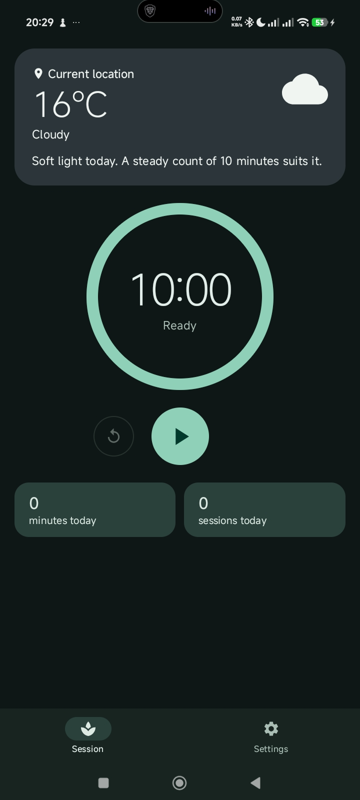
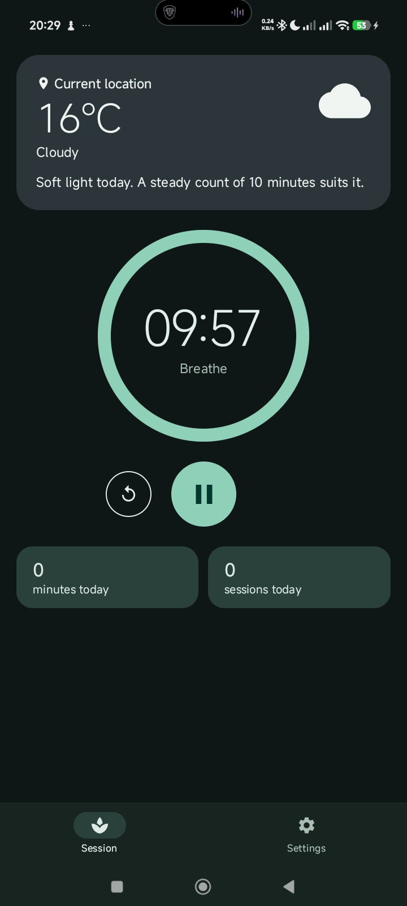
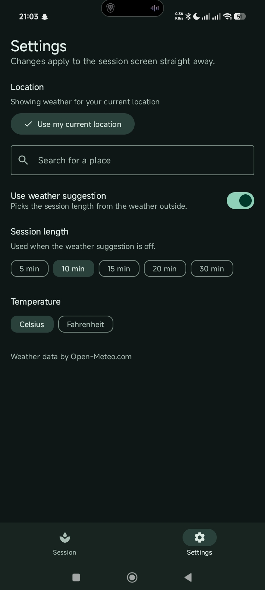

# Calm Skies

A meditation timer that checks the weather where you are and suggests how long to sit.

Open the app and you see the weather, one suggested session length, a big countdown ring and today's totals. Nothing else gets in the way. Built for **CP3406 / CP5307 Assessment 1: Utility App** (James Cook University).

<p align="center">
  
  &nbsp;
  
  &nbsp;
  
</p>
<p align="center"><em>Ready to start &nbsp;|&nbsp; Session running &nbsp;|&nbsp; Settings</em></p>

## Why it is a utility app

The main screen answers one question at a glance: *how long should I sit today, and how is my session going?* It shows only the weather and a suggestion, a single timer and two small totals. There is one big button to start or pause. Everything you can change lives on the Settings screen, and each setting changes the main screen straight away.

## Features

| Feature | What it does |
|---|---|
| Weather where you are | Uses the phone's location (with permission) to show the current weather. |
| Weather anywhere | Search for any place by name and the whole app switches to its weather. There is no fixed list of cities. |
| Weather-based suggestion | The weather card suggests a session length that suits the conditions, for example 15 minutes on a rainy day and 5 on a stormy one. |
| Countdown ring | A large ring empties as the session runs, with the time left in the middle. |
| One-button control | Start, pause and resume with one button, plus reset. The phone gives a short buzz when a session ends. |
| Today's totals | Minutes meditated and sessions completed since the app was opened. |
| Tinted weather card | The card colour follows the weather (sunny, cloudy, fog, rain, snow, storm). |
| Light and dark themes | A calm moss-green theme that follows the phone's light or dark setting. |
| Handles problems calmly | If location permission is missing, location is off, or there is no internet, the card explains what is wrong and offers a button to fix it. The timer keeps working. |

### Settings

Every setting changes the session screen immediately.

- **Location:** "Use my current location", or type a place name and tap a result.
- **Use weather suggestion:** take the session length from the weather, or from the length you choose.
- **Session length:** 5, 10, 15, 20 or 30 minutes (used when the suggestion is off).
- **Temperature:** Celsius or Fahrenheit.

Settings are not saved between launches, as the assessment brief allows.

## Tech stack

- **Language:** Kotlin
- **UI:** Jetpack Compose with Material Design 3 (custom colour scheme, typography and shapes)
- **Architecture:** ViewModel, Repository pattern, manual dependency injection, `StateFlow` with lifecycle-aware collection
- **Networking:** Retrofit with Gson
- **Location:** Google Play services (fused location provider)
- **Testing:** JUnit and `kotlinx-coroutines-test`
- **Minimum Android version:** API 26 (Android 8.0)

### Web services (no API keys needed)

| Service | Used for |
|---|---|
| [Open-Meteo forecast API](https://open-meteo.com) | Current temperature, weather code and day/night |
| [Open-Meteo geocoding API](https://open-meteo.com/en/docs/geocoding-api) | Searching for a place by name |

## How it is built

```
MainActivity
  └── UtilityApp()                 connects the ViewModel to the UI, asks for location permission,
        │                          buzzes at the end of a session
        └── UtilityAppContent()    Scaffold + bottom navigation (Session / Settings)
              ├── UtilityScreen()  weather card, timer ring, controls, totals
              └── SettingsScreen() location search, switch and chips

MeditationViewModel ─┬─ WeatherRepository  ── WeatherApi   (Retrofit) ── api.open-meteo.com
   StateFlow<WeatherUiState>      ├─ PlaceRepository    ── GeocodingApi (Retrofit) ── geocoding-api.open-meteo.com
   StateFlow<PlaceSearchState>    └─ LocationRepository ── Google Play services
   StateFlow<TimerUiState>
   StateFlow<MeditationSettings>
   StateFlow<DayStats>
```

### Project structure

| Folder | Role |
|---|---|
| `data/remote` | Retrofit interfaces (`WeatherApi`, `GeocodingApi`) and the JSON models |
| `data/model` | App models: `Weather`, `WeatherCondition`, `Place`, `Coordinates`, `TemperatureUnit` |
| `data` | `WeatherRepository`, `PlaceRepository`, `LocationRepository` (an interface and an implementation each) |
| `di` | `AppContainer`, which builds the two Retrofit instances and the repositories |
| `ui` | Screens, `MeditationViewModel`, UI state, settings, weather wording and icons |
| `ui/components` | Reusable composables: `WeatherCard`, `TimerRing`, `TimerControls`, `DayStatsRow`, `ChoiceChips`, `SettingsSection` |
| `ui/theme` | Colours, typography, shapes and the weather tints |

### Where each week's topic is used

| Week | Topic | Used in |
|---|---|---|
| 1 | Kotlin and Android Studio setup | Whole project, `MainActivity.kt` |
| 2 | Layouts using Jetpack Compose | `UtilityScreen`, `SettingsScreen`, `WeatherCard`, and the `Canvas` drawing in `TimerRing` |
| 3 | Material Design 3 principles | `CalmSkiesTheme` (light and dark schemes, shapes, typography), `FilterChip`, `Switch`, `FilledIconButton`, `NavigationBar` |
| 4 | App architecture (ViewModel, DI, Repository) | `MeditationViewModel`, `AppContainer`, the three repositories |
| 5 | Web APIs using Retrofit | `WeatherApi`, `GeocodingApi`, the DTO files, `DefaultAppContainer` (two base URLs) |

### Implementation notes

- **State flows one way.** The ViewModel exposes `StateFlow`s, the UI collects them with `collectAsStateWithLifecycle`, and user actions go back up as lambdas.
- **One ViewModel for both screens**, so a setting change shows on the session screen, and the timer survives screen rotation.
- **Stale requests are cancelled.** Choosing a new place quickly cancels the previous weather request, and a new search replaces an older one.
- **Search is debounced.** The place search waits 400 ms after typing stops and ignores very short text.
- **Failures are values, not crashes.** The repositories return `Result`; the ViewModel turns a failure into an error state with a clear message and a retry button.
- **A running session is never changed.** Settings and weather only change the length of an idle timer.
- **Location permission** is requested once automatically on first launch, again from the "Allow location" button, and from "Use my current location". Approximate location is enough.
- **Two hosts, two Retrofit instances.** The weather and place-search services have different base URLs.
- **Weather codes** from the API (WMO codes) are mapped to six simple conditions in `WeatherCondition.fromCode`.

## Running the app

1. Clone this repository and open it in Android Studio.
2. Let Gradle sync finish.
3. Run on a phone or emulator (API 26 or higher) with internet access and Google Play services.
4. On an emulator, set a location first (the "..." menu, then **Location**) so "current location" has something to find.

## Tests

```
./gradlew test
```

- `WeatherConditionTest`: weather code to condition mapping.
- `NetworkWeatherRepositoryTest`: success, night flag, temperature unit sent, network error, missing data.
- `NetworkPlaceRepositoryTest`: place mapping, empty results, incomplete results skipped, network error.
- `MeditationViewModelTest`: location permission and errors, place search (debounce, empty, error), choosing a place, suggested length, countdown, pause, finishing a session, reset.

## Known limitations

- Needs internet for the weather and place search. Without it the timer still works, but no suggestion is shown.
- The current location is shown as "Current location" rather than a town name (no reverse geocoding).
- Needs Google Play services for the phone's location. Use an emulator image that includes Google APIs.
- If location permission is permanently denied it can only be turned back on in the phone's app settings. Searching for a place still works.
- Settings and today's totals reset when the app is closed.
- The timer runs inside the app. If Android closes the app in the background, the session stops.

## Credits

- Weather data and place search by [Open-Meteo.com](https://open-meteo.com) (free, no API key).
- Device location from Google Play services.
- Generative AI was used to help learn Kotlin and Jetpack Compose. See the Declaration of AI-Generated Material submitted with the assignment.
